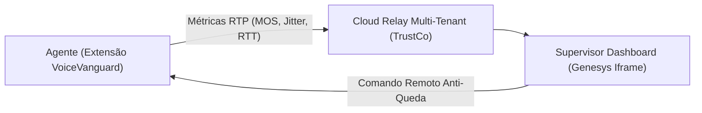

# VoiceVanguard WebRTC Sentinel &bull; Pitch Executivo & One-Pager

> **Observabilidade de voz em tempo real, auditoria de MOS (ITU-T G.107) e remediação remota de navegadores para Contact Centers em Nuvem (CCaaS).**
> **Desenvolvido por TrustCo Technologies** &bull; [trustco.pro](https://trustco.pro) &bull; `voicevanguard.trustco.pro`

---

## 1. O Problema Crítico
Nos contact centers modernos (Genesys Cloud CX, Amazon Connect, Twilio, Webex, Five9), a telefonia opera 100% no navegador do atendente via WebRTC. Isso gera três desafios graves que aumentam custos operacionais e frustram clientes:
1. **O "Fantasma" da Ligação Muda/Robô:** Operadores e supervisores culpam a infraestrutura de telefonia, quando 85% das falhas são causadas por instabilidade no Wi-Fi doméstico do operador, saturação de CPU local da máquina ou bufferbloat de rede.
2. **Tempo Excessivo de Resolução do N1/N2 de TI:** Diagnosticar problemas intermitentes de voz exige abertura de chamados demorados, coleta complexa de dumps SIP e perda de produtividade da PA.
3. **Degradação de Navegador por Cache Acumulado:** Centenas de abas abertas e gigabytes de cache acumulados degradam o processo Chromium ao longo da jornada, causando travamentos e quedas súbitas de chamada.

---

## 2. A Solução: VoiceVanguard CCaaS
O **VoiceVanguard** é um ecossistema corporativo white-label composto por uma extensão ultraleve de telemetria no navegador e uma central de comando em tempo real para supervisores:

- **Interceptor WebRTC Universal:** Captura estatísticas nativas de pacotes RTP (`getStats()`) diretamente no navegador sem exigir SDKs pesados de telefonia ou permissões invasivas.
- **Cálculo de MOS em Tempo Real (ITU-T G.107):** Avalia a qualidade percebida da chamada de 1.00 a 4.50 nota a cada segundo da interação.
- **Auditoria de Chamadas com ConversationID / CallSid:** Vincula automaticamente o histórico da chamada ao operador e estação.
- **Limpeza Segura de Cache com Trava Operacional:** O supervisor dispara a limpeza de cache da PA remotamente com 1 clique. Se o agente estiver em atendimento, o sistema aguarda o término da chamada para não derrubar a ligação.
- **Total Compliance LGPD / GDPR:** **Zero escuta e zero gravação de áudio.** Apenas telemetria estatística de rede.

---

## 3. Modelo de Negócios & Projeção Financeira

### Preço de Subscrição (PUPM - Per User Per Month)
| Plano | Faixa de PAs | Preço / PA / mês | SLA de Suporte |
| :--- | :--- | :--- | :--- |
| **Standard** | Até 500 PAs | **\$6,50 USD** | 8x5 Comercial |
| **Enterprise** | 501 a 2.500 PAs | **\$5,50 USD** | 24x7 Crítico |
| **Global BPO** | Acima de 2.500 PAs | **\$4,50 USD** | Dedicado + Custom Webhooks |

### Exemplo de Receita Recorrente (ARR):
- **1 BPO Médio (1.000 PAs):** \$5.500/mês &rarr; **\$66.000 USD/ano** (~R\$ 360.000/ano).
- **5 Clientes AppFoundry (5.000 PAs):** \$27.500/mês &rarr; **\$330.000 USD/ano** (~R\$ 1,8 milhão/ano).

---

## 4. Diferenciais Competitivos

| Funcionalidade | Ferramentas Nativas (Genesys Admin) | Monitoramento Tradicional (Zabbix/Dynatrace) | **VoiceVanguard CCaaS** |
| :--- | :---: | :---: | :---: |
| **Métrica no Nível da Aba** | Parcial | Não | **Sim (WebRTC Nativo)** |
| **Diagnóstico de Wi-Fi vs CPU** | Não | Parcial | **Sim (Instantâneo)** |
| **Limpeza de Cache Remota Segura** | Não | Não | **Sim (Com Trava Anti-Queda)** |
| **Implantação Zero-Touch (GPO/Intune)** | Não | Complexa | **Sim (1 clique via Active Directory)** |
| **Agnóstico a CCaaS** | Só Genesys | Não | **Genesys, Amazon Connect, Twilio, etc.** |

---

## 5. Informações da Fabricante & Contato
- **Desenvolvedora:** TrustCo Technologies
- **Website:** `https://trustco.pro`
- **Portal da Solução:** `https://voicevanguard.trustco.pro`
- **Ambiente de Testes:** chave de avaliação fornecida sob solicitação (`partnerships@trustco.pro`)
- **Contato Comercial & Parcerias:** `partnerships@trustco.pro`
